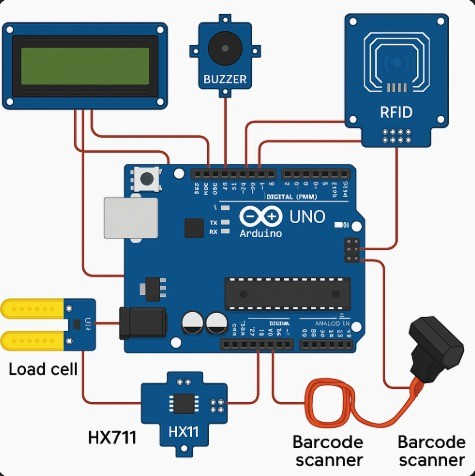
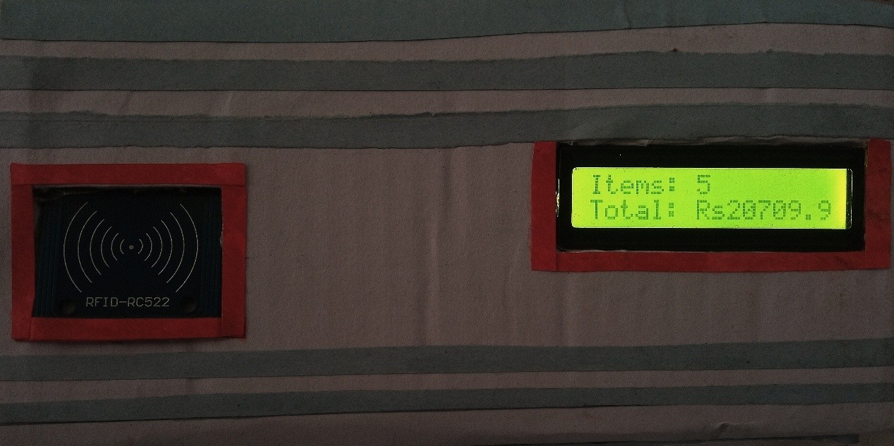
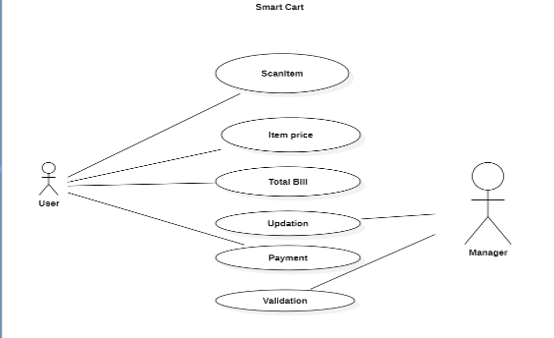

# SmartCart Engineering Documentation

> **Autonomous Retail Self-Checkout & Anti-Theft Cart System Using Arduino Uno**  
> *Hardware-Software Integration, Anti-Tampering Algorithms, Pinout Specifications, and Performance Evaluation*

---

## Table of Contents
1. [Executive Summary & Background](#1-executive-summary--background)
2. [Project Scope](#2-project-scope)
3. [System Hardware Architecture](#3-system-hardware-architecture)
4. [Hardware Integration & Wiring Diagram](#4-hardware-integration--wiring-diagram)
5. [Physical Prototype & Chassis Assembly](#5-physical-prototype--chassis-assembly)
6. [Use Case & System Behavioral Modeling](#6-use-case--system-behavioral-modeling)
7. [Firmware Implementation & Algorithms](#7-firmware-implementation--algorithms)
8. [Comprehensive Testing & Test Cases](#8-comprehensive-testing--test-cases)
9. [Experimental Results & Performance Analysis](#9-experimental-results--performance-analysis)
10. [Challenges, Engineering Solutions & Limitations](#10-challenges-engineering-solutions--limitations)
11. [Future Enhancements](#11-future-enhancements)

---

## 1. Executive Summary & Background

### 1.1 Background & Motivation
In contemporary brick-and-mortar supermarkets and grocery chains, check-out lines represent the single most substantial friction point in the customer journey. Shoppers often spend more time waiting in stationary queues than actively browsing aisles. For store owners, conventional manual checkout incurs significant recurring labor expenses while remaining susceptible to cashier fatigue, barcode scanning errors, and shrinkage.

**SmartCart** transforms the physical shopping trolley into an autonomous, self-contained checkout station. Utilizing dual-input RFID and barcode product identification, combined with real-time weight differential verification via a load cell, the cart automatically identifies products, verifies them against fraud, and tallies the bill instantly.

### 1.2 Sustainable Development Goals (SDGs)
- **UN SDG 8 (Decent Work & Economic Growth):** Reduces repetitive manual barcode handling for supermarket cashiers, transitioning staff towards higher-value customer service roles.
- **UN SDG 9 (Industry, Innovation & Infrastructure):** Integrates accessible IoT hardware into conventional retail environments without requiring high-cost ceiling camera matrices (such as Amazon Go).
- **UN SDG 12 (Responsible Consumption & Production):** Delivers live on-screen cost and item tallies to prevent impulse over-spending and discrepancies.

---

## 2. Project Scope

To ensure high engineering stability and focus on the embedded prototype, the scope is defined as follows:

### Included in the Project:
- **Dual Product Identification**: Contactless 13.56 MHz RFID tag sensing (MFRC522) and standard 1D/2D Barcode decoding over UART.
- **Physical Anti-Tampering & Weight Gate**: A base-mounted strain-gauge load cell with an HX711 24-bit ADC amplifier to verify that scanned items are physically placed into the cart.
- **Autonomous Cart State Manager**: Dynamic cart addition ($\Delta W > +20\text{g}$) and automated deduction upon item removal ($\Delta W < -20\text{g}$).
- **Active Anti-Theft Siren**: Continuous background surveillance that detects un-scanned payload insertions ($>40\text{g}$) during idle periods.
- **Dynamic User Feedback**: A 20x4 character I2C LCD providing instantaneous item feedback followed by an automatic 3-second switch to total bill calculations.
- **Acoustic Signaling**: Multi-pattern piezo buzzer signals for confirmation, warnings, and security violations.

### Excluded from the Present Scope:
- Smartphone companion applications (no Bluetooth/Wi-Fi stack).
- Cloud synchronization or centralized distributed databases.
- Integration with payment gateway hardware (credit cards, UPI, NFC payment).
- Enterprise POS ERP back-office synchronization.

---

## 3. System Hardware Architecture

The SmartCart embedded hardware consists of modular, low-power industrial and prototyping components driven by an **Arduino Uno (ATmega328P)**.

```
       +-----------------------------------------------------------+
       |                        Arduino Uno                        |
       |                       (ATmega328P)                        |
       +-----+----------------+-------------+------------+---------+
             | SPI            | UART        | 2-Wire     | I2C (0x27)
             v                v             v            v
     +---------------+ +--------------+ +---------+ +-------------+
     | MFRC522 RFID  | | Barcode      | | HX711   | | 20x4 LCD    |
     | Reader        | | Scanner      | | + Load  | | Display     |
     | (13.56 MHz)   | | (TTL Serial) | | Cell    | | (I2C)       |
     +---------------+ +--------------+ +---------+ +-------------+
                                                 |
                                                 v
                                          +-------------+
                                          | 5V Active   |
                                          | Buzzer (D8) |
                                          +-------------+
```

### 3.1 Hardware Components & Pinout

| Component | Interface / Pins | Arduino Uno Connection | Operating Voltage | Function |
|---|---|---|---|---|
| **MFRC522 RFID** | SPI (SDA, SCK, MOSI, MISO, RST) | `D10`, `D13`, `D11`, `D12`, `D9` | **3.3V** | Contactless high-speed item detection |
| **Barcode Scanner** | TTL UART (TX, RX) | `D2` (RX), `D3` (TX) via `SoftwareSerial` | **5.0V** | Scans conventional grocery packaging |
| **HX711 + Load Cell** | Serial 2-Wire (DOUT, SCK) | `D4` (DOUT), `D5` (SCK) | **5.0V** | High-precision 24-bit weight measurement |
| **I2C LCD Display** | I2C (SDA, SCL) | `A4` (SDA), `A5` (SCL) | **5.0V** | Real-time shopper UI & bill display |
| **Piezo Buzzer** | Digital GPIO | `D8` | **5.0V** | Multi-frequency status & theft siren |
| **Power Supply** | 5V / 2A DC Regulated | USB Port / 5V Rail | **5.0V** | Powers all active electronics |

---

## 4. Hardware Integration & Wiring Diagram

The physical interconnection of all modules with the Arduino Uno is illustrated below:


*Figure 4.1: Hardware connection diagram of the SmartCart system showing integration of RFID module, barcode scanner, load cell with HX711, LCD, and buzzer with Arduino Uno.*

### Electrical Details:
1. **MFRC522 Power Isolation**: The MFRC522 reader requires strict **3.3V** VCC. Connecting it to the 5V line can permanently damage the NXP chip. The SPI communication lines (`D9`-`D13`) interface directly with the Arduino digital pins.
2. **HX711 Differential Sampling**: The load cell uses a full Wheatstone bridge (Red: E+, Black: E-, White: A-, Green: A+) wired to the HX711 analog inputs, which amplifies small microvolt variations into 24-bit digital numbers for pins `D4` and `D5`.
3. **I2C Bus Simplicity**: The LCD backpack utilizes the PCF8574 I2C expander at fixed address `0x27`, reducing the display pin requirement from 16 GPIOs down to just 2 analog pins (`A4`, `A5`).

---

## 5. Physical Prototype & Chassis Assembly

The prototype was constructed by outfitting a test cart chassis with rigid structural mountings to ensure sensor stability and reduce false strain-gauge readings during transit.


*Figure 5.1: Physical working prototype showing the MFRC522 RFID reader flush-mounted on the chassis alongside the live 20x4 LCD displaying item count and running total.*

### Mechanical Considerations:
- **Load Cell Isolation**: The load cell is bolted between an acrylic base plate and the suspended cart basket. Dampening washers absorb wheel vibration while the cart rolls across retail tiles.
- **Front-Facing Scan Bay**: The RFID reader and barcode scanning window are mounted side-by-side at the handle console for quick, intuitive one-handed scanning.

---

## 6. Use Case & System Behavioral Modeling

The system establishes direct interaction with the shopper while enabling administrative validation by store managers.


*Figure 6.1: Use case diagram of SmartCart illustrating user and manager interactions with scanning, pricing, cart updation, total billing, and validation.*

### Primary Operational Scenarios:

```
[ Shopper Scans Item ]
          │
          ▼
[ Item ID Found in DB? ] ─── No ────► [ Emit 5 Error Beeps & Ignore ]
          │
         Yes
          │
          ▼
[ Wait 1000ms for Weight Stabilization ]
          │
          ▼
[ Calculate Weight Delta (ΔW) ]
          │
   ┌──────┴───────────────────────────┐
   │                                  │
ΔW > +20g                          ΔW < -20g                     |ΔW| ≤ 20g
   │                                  │                              │
   ▼                                  ▼                              ▼
[ Add Item (+1) ]             [ Deduct Item (-1) ]         [ Emit 3 Warning Beeps ]
[ Beep Buzzer (1x) ]          [ Beep Buzzer (1x) ]         [ Item Not In Cart ]
[ Show Name & Price ]         [ Show Name & Price ]        [ No Bill Modification ]
   │                                  │
   └───────────────┬──────────────────┘
                   │
                   ▼
       [ Inactivity ≥ 3000ms? ]
                   │
                  Yes
                   ▼
     [ Display Total Bill & Count ]
```

---

## 7. Firmware Implementation & Algorithms

The firmware is written in C++ and compiled using the Arduino toolchain. The complete logic is implemented in [`SmartCart.ino`](SmartCart.ino).

### 7.1 Product Database Structs
The items are stored in static RAM using lightweight C++ data structures:

```cpp
struct Item {
  String name;
  float price;
  int quantity;
};

struct Product {
  String id;
  String name;
  float price;
};

// Internal verified catalog
Product database[] = {
  {"123456789",       "Milk",        32.00},
  {"ABC123",          "Bread",        5.50},
  {"RFID_04AABBCCDD", "Eggs",         7.25},
  {"RFID_02FF336677", "Juice",        3.75},
  {"6973224080711",   "Butter",       4.99},
  {"RFID_D3CF52C5",   "Daru",      6900.00},
  {"8901396062417",   "JootaPolish",1000.00}
};
```

### 7.2 Dynamic Cart Array Management
The `updateCart()` algorithm operates in $O(N)$ lookup and shifts elements upon removal to prevent memory fragmentation:

```cpp
void updateCart(String name, float price, int deltaQty) {
  for (int i = 0; i < cartCount; i++) {
    if (cart[i].name == name) {
      cart[i].quantity += deltaQty;
      if (cart[i].quantity <= 0) {
        // Shift remaining items left
        for (int j = i; j < cartCount - 1; j++) {
          cart[j] = cart[j + 1];
        }
        cartCount--;
      }
      return;
    }
  }
  if (deltaQty > 0 && cartCount < MAX_ITEMS) {
    cart[cartCount].name = name;
    cart[cartCount].price = price;
    cart[cartCount].quantity = deltaQty;
    cartCount++;
  }
}
```

### 7.3 Weight Differential Anti-Theft Logic
When an RFID or Barcode scan occurs, the firmware samples the cart weight baseline, delays $1000\text{ms}$ for the object to settle, and compares the delta:

$$\Delta W = W_{\text{after}} - W_{\text{before}}$$

- **Item Added**: If $\Delta W > +20.0\text{g}$, the item is validated and appended to the cart.
- **Item Removed**: If $\Delta W < -20.0\text{g}$, the item is recognized as returned and deducted from the running tally.
- **Zero Delta (Theft/Fraud Attempt)**: If $|\Delta W| \le 20.0\text{g}$, the shopper merely scanned the tag without putting the item in the cart. The transaction is ignored, and 3 warning beeps are emitted.

### 7.4 Continuous Background Anti-Tamper Engine
To prevent un-scanned items from being slipped into the cart, the loop runs a background watch:

```cpp
if (millis() - lastCheatCheck > 500) {
  float weightDiff = currentWeight - lastWeight;
  if ((weightDiff > 40.0) && (millis() - lastScanTime > 5000)) {
    cheatDetected = true;
    Serial.println("CHEATING DETECTED!");
    unsigned long cheatStart = millis();
    while (millis() - cheatStart < 10000) {
      digitalWrite(BUZZER_PIN, HIGH);
      delay(100);
      digitalWrite(BUZZER_PIN, LOW);
      delay(100);
    }
  }
  lastWeight = currentWeight;
  lastCheatCheck = millis();
}
```
If an unverified mass ($>40\text{g}$) is added after 5 seconds of idle scanning, the system locks into a **10-second rapid siren**.

---

## 8. Comprehensive Testing & Test Cases

The system underwent 10 structured validation test cases covering hardware, software, and real-world failure scenarios:

| # | Test Scenario | Objective | Procedure | Expected Outcome | Result |
|---|---|---|---|---|---|
| **TC-01** | Valid RFID Scan | Verify tag recognition and cart increment | Pass authorized RFID card over MFRC522 and place item into basket | Item recognized, 1 beep, LCD displays name & price, cart tally updated | **Passed** |
| **TC-02** | Unregistered RFID Scan | Ensure invalid tags are rejected | Present unregistered tag UID | Display ignored, emit 5 warning beeps, cart unchanged | **Passed** |
| **TC-03** | Weight Validation | Confirm load cell accuracy | Scan item and place exact matching item | Mass detected ($>20\text{g}$), item accepted into cart | **Passed** |
| **TC-04** | Zero Weight Delta | Detect scanned items not placed in cart | Scan tag but hold item in hand | System refuses transaction, emits 3 beeps | **Passed** |
| **TC-05** | Barcode Decoding | Verify TTL serial scanner communication | Scan EAN-13 printed retail barcode | Decoded string matched in DB, item added | **Passed** |
| **TC-06** | Duplicate Rapid Scans | Test debounce and rapid repeated reads | Scan same RFID card twice within 1 second | Second immediate scan rejected without duplicate charge | **Partially Passed** *(improved with debounce timer)* |
| **TC-07** | Consecutive Scans | Test stream processing under rapid load | Scan multiple distinct products in quick succession | All items queued and computed in sequence | **Passed** |
| **TC-08** | LCD Auto-Toggle | Verify 3-second display state engine | Scan item, then leave cart idle for $>3$ seconds | Display switches from item details to total bill summary | **Passed** |
| **TC-09** | Power Interruption | Evaluate system state after sudden reboot | Disconnect power bank during shopping session | Clean boot, load cell re-tares safely | **Passed** *(Cart resets to 0)* |
| **TC-10** | Bill Calculation | Validate mathematical integrity of running totals | Scan multiple items with varying prices and quantities | LCD calculated total matches manual arithmetic exactly | **Passed** |

---

## 9. Experimental Results & Performance Analysis

### 9.1 Quantitative Evaluation Summary

| Performance Metric | Evaluation Method | Sample Size | Observed Result | Target Benchmark |
|---|---|---|---|---|
| **RFID Detection Rate** | Varied orientations at $2\text{--}3\text{ cm}$ | 20 scans | **95.0%** (19/20) | $> 90.0\%$ |
| **Barcode Detection Rate** | Normal indoor ambient retail lighting | 15 scans | **100.0%** (15/15) | $> 98.0\%$ |
| **Weight Sensor Precision** | Calibrated against standard 500g, 1000g masses | 10 trials | **96.5%** ($\pm 3.5\text{g}$ avg error) | $\pm 5.0\text{g}$ |
| **System Response Time** | Elapsed time from scan to LCD update | 5 trials | **1.65 seconds avg** (1.3s – 1.9s) | $< 2.0\text{s}$ |
| **Theft Error Detection** | Weight mismatch & unscanned item injection | 10 trials | **100.0%** (All violations flagged) | $100\%$ |
| **Display Stability** | Continuous stress operation | 20 scans | **100.0%** (No lockup/corruption) | $100\%$ |

### 9.2 Error Distribution Breakdown
During stress-testing simulations, detected errors were categorized as:
- **RFID Tag Not Found**: $40\%$ (Caused by misaligned or unregistered tag IDs)
- **Weight Mismatch / Tamper**: $30\%$ (Scanned item not dropped or un-scanned mass inserted)
- **Duplicate Scan Attempts**: $30\%$ (Shopper scanning twice within rapid succession)

---

## 10. Challenges, Engineering Solutions & Limitations

### 10.1 Key Engineering Challenges Encountered

1. **RFID Reader Sensitivity & Operational Range**
   - *Challenge*: The MFRC522 has an effective read distance of only $2\text{--}3\text{ cm}$. Angled tags or tags behind thick packaging occasionally missed detection.
   - *Solution*: Relocated reader to a flush-mount position on the basket rim and marked the optimal touch-point clearly for users.
2. **Mechanical Load Cell Vibration & Drift**
   - *Challenge*: Moving carts vibrate on uneven floor surfaces, triggering noisy analog readings from the HX711.
   - *Solution*: Added a $1000\text{ms}$ stabilization window after scans and set an intentional deadband filter ($\pm 20\text{g}$) to reject road noise.
3. **Duplicate Scan Prevention**
   - *Challenge*: Barcode scanners continuously stream characters if held down.
   - *Solution*: Implemented debounce time windows and single-scan serial flushing in firmware.

### 10.2 Current Prototype Limitations
- **Static In-Memory Database**: Prices and IDs are hardcoded in the sketch array; changing prices currently requires re-flashing the ATmega328P.
- **No On-Cart Payment Gateway**: The current version tallies and locks the final total on-screen, but the shopper must settle the payment at an exit counter.
- **RAM Session Retention**: Power cycling wipes current cart contents, as cart items are stored in volatile SRAM rather than non-volatile EEPROM.

---

## 11. Future Enhancements

1. **UHF Long-Range RFID Integration**: Upgrading from the MFRC522 to an 860–960 MHz UHF RFID reader to detect all items placed into the cart volume without requiring manual touch-scanning.
2. **Dynamic Database via SD Card / EEPROM**: Migrating product records to an onboard MicroSD SPI card module, allowing retail managers to update store prices simply by replacing a CSV file.
3. **Wireless Telemetry & Payment**: Incorporating an ESP32 or ESP8266 Wi-Fi co-processor to transmit cart totals directly to a store billing server and display dynamic payment QR codes (UPI / Stripe).
4. **Battery Fuel Gauge & Low-Power Sleep**: Implementing an analog battery voltage divider to warn shoppers of low battery charge and entering sleep modes during cart idle time.
