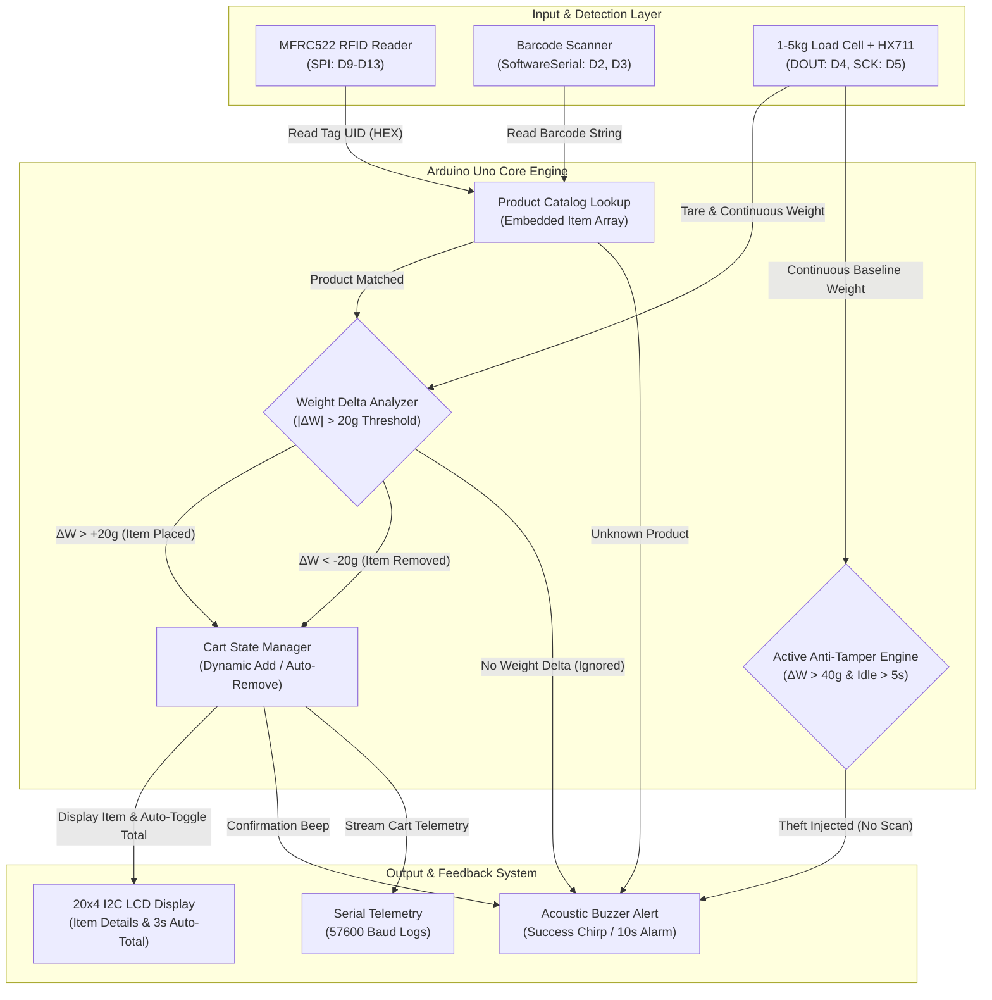

# ⚡ SmartCart

---

> An autonomous retail IoT shopping cart featuring dual-input RFID & Barcode item recognition, dynamic HX711 anti-theft weight verification, and real-time on-cart LCD billing.

[](#)
[](#)
[](#)
[](#)
[](#)
[](#)

🚀 [Quick Start](#-quick-start) • 🧩 [How It Works](#-how-it-works) • 💡 [Key Features](#-key-features) • 🛠️ [Hardware & Pinout](#️-hardware--pinout-configuration) • 📊 [Testing & Results](#-testing--performance-results) • 📖 [Full Documentation](DOCUMENTATION.md)

---

## 📌 Overview

Traditional supermarket checkout processes force shoppers to wait in long, congested queues while store personnel manually scan every single product. **SmartCart** solves this friction by turning the shopping cart itself into an autonomous point-of-sale checkout kiosk.

Equipped with an **Arduino Uno**, an **MFRC522 RFID reader**, a **TTL Barcode scanner**, a **load cell with HX711 amplifier**, and a **20x4 I2C LCD**, SmartCart automatically identifies items, validates their physical weight against expected database limits to prevent theft, updates the running bill, and displays live checkout calculations in real time.

---

## 🧩 How It Works



> **The key design rule:** The anti-theft validation gate verifies instantaneous load cell weight deltas against scanned items ($\pm 20\text{g}$ threshold) and continuously monitors for un-scanned payload injections ($>40\text{g}$ threshold after 5s idle), triggering instant audible alerts before any bill modification occurs.

---

## 💡 Key Features

- **Dual-Technology Identification**: Supports both contactless **13.56 MHz RFID tags (MFRC522)** and standard **1D/2D Barcodes (UART)** for complete retail backwards-compatibility.
- **Hardware Anti-Theft & Tamper Verification**: A calibrated load cell coupled with an HX711 ADC samples the physical payload before and after scans. If an item is scanned without being placed inside the cart, the transaction is rejected.
- **Bi-Directional Cart Management**:
  - Placing an item increases item quantity ($\Delta W > +20\text{g}$).
  - Removing an item automatically deducts it from the cart and updates the running total ($\Delta W < -20\text{g}$).
- **Continuous Unscanned Item Detection**: If an unscanned object ($>40\text{g}$) is dropped into the basket during an idle period ($>5\text{s}$ post-scan), a 10-second continuous security alarm sounds.
- **Dynamic 3-Second LCD Display Engine**: 
  - Displays instant item name, price, and scanned quantity upon detection.
  - Automatically flips to the comprehensive bill summary (`Items: N | Total: Rs XX.XX`) after 3 seconds of idle time.
- **Multi-Level Acoustic Feedback**:
  - `1 Beep (200ms)`: Successful item addition or deduction.
  - `3 Beeps`: Item scanned but not placed into cart (zero weight change).
  - `5 Beeps`: Unrecognized RFID tag or barcode string.
  - `10s Pulsed Siren`: Active theft attempt detected.

---

## 🛠️ Hardware & Pinout Configuration

### Bill of Materials (BOM)
All components used in the current prototype:
1. **Microcontroller**: Arduino Uno (ATmega328P)
2. **RFID Reader**: MFRC522 (13.56 MHz, SPI Interface)
3. **Barcode Scanner**: USB/TTL Serial Barcode Scanner (9600 Baud)
4. **Weight Sensor**: 1–5 kg Aluminum Load Cell with HX711 24-bit ADC Amplifier
5. **Display**: 20x4 (or 16x2) Character LCD with PCF8574 I2C Backpack (`0x27`)
6. **Acoustic Indicator**: 5V Active Buzzer
7. **Power Source**: 5V / 2A Regulated USB Power Bank or Battery Pack

### Microcontroller Pin Mapping Table

| Component | Module Pin | Arduino Uno Pin | Protocol / Description |
|---|---|---|---|
| **MFRC522 RFID** | SDA (SS) | `D10` | SPI Slave Select |
| | SCK | `D13` | SPI Clock |
| | MOSI | `D11` | SPI Master Out Slave In |
| | MISO | `D12` | SPI Master In Slave Out |
| | RST | `D9` | Reset Pin |
| | 3.3V / GND | `3.3V` / `GND` | **Note:** 3.3V Power Only |
| **Barcode Scanner** | TX | `D2` | SoftwareSerial RX (from scanner TX) |
| | RX | `D3` | SoftwareSerial TX (to scanner RX) |
| | VCC / GND | `5V` / `GND` | Power Supply |
| **HX711 Amplifier** | DOUT (DT) | `D4` | Digital Data Out |
| | SCK (CLK) | `D5` | Clock Input |
| | VCC / GND | `5V` / `GND` | Power Supply |
| **I2C LCD Display** | SDA | `A4` | I2C Data (Address `0x27`) |
| | SCL | `A5` | I2C Clock |
| | VCC / GND | `5V` / `GND` | 5V Power Supply |
| **Buzzer** | Signal (+) | `D8` | Digital Output Pin |
| | GND (-) | `GND` | Common Ground |

---

## 🚀 Quick Start

### 1. Prerequisites & Required Libraries
Ensure you have the [Arduino IDE](https://www.arduino.cc/en/software) installed along with these libraries:
- `MFRC522` by GithubCommunity
- `HX711_ADC` by Olav Kallhovd
- `LiquidCrystal_I2C` by Frank de Brabander
- Standard embedded libraries: `Wire`, `SPI`, `SoftwareSerial`

### 2. Wiring & Assembly
Connect the sensors according to the [Pin Mapping Table](#️-hardware--pinout-configuration). Refer to [`images/Picture1.jpg`](images/Picture1.jpg) for the hardware wiring layout.

### 3. Calibration of Load Cell
In `SmartCart.ino`, the calibration factor is preset for the prototype load cell:
```cpp
LoadCell.setCalFactor(445.03);  // Calibrated for 1-5kg load cell
```
If your load cell differs, run the standard `HX711_ADC` calibration sketch to obtain your specific factor and update line 175.

### 4. Upload Firmware
1. Open [`SmartCart.ino`](SmartCart.ino) in Arduino IDE.
2. Select **Board**: `Arduino Uno` and choose your COM port.
3. Click **Upload**.
4. Open the **Serial Monitor** at `57600 baud` to view real-time diagnostics and tare status.

---

## 📊 Testing & Performance Results

Extensive validation trials documented in the project report yielded the following operational performance metrics:

| Metric | Measured Result | Benchmark Target | Status |
|---|---|---|---|
| **RFID Detection Accuracy** | **95.0%** (19/20 successful reads) | $> 90.0\%$ | ✅ Passed |
| **Barcode Scan Accuracy** | **100.0%** (15/15 clean scans) | $> 98.0\%$ | ✅ Passed |
| **Load Cell Precision** | **$\pm 3.5\text{g}$** deviation | $<\pm 5.0\text{g}$ | ✅ Passed |
| **Average Response Time** | **1.65 seconds** (1.3s – 1.9s) | $< 2.0\text{s}$ | ✅ Passed |
| **Anti-Theft Error Detection** | **100.0%** (Flagged all unverified items) | $100\%$ | ✅ Passed |
| **LCD Stability** | **100.0%** (No freeze during rapid scans) | $100\%$ | ✅ Passed |

---

## 📁 Repository Structure

```plaintext
SmartCart-Using-Ardiuno/
├── images/
│   ├── Picture1.jpg       # Hardware integration and wiring schematic
│   ├── Picture2.jpg       # Working prototype photograph on cart chassis
│   └── Picture3.png       # SmartCart use-case UML diagram
├── DOCUMENTATION.md       # Full engineering report, circuit design & algorithms
├── LICENSE                # MIT License
├── README.md              # Project landing page & quick start guide
├── SmartCart.ino          # Arduino firmware (C++)
└── report.txt             # Academic project report source text
```

---

## 📖 Complete Documentation

For an in-depth breakdown of the hardware architecture, circuit schematics, embedded anti-theft algorithms, test matrices, and future design enhancements, see the complete [📖 DOCUMENTATION.md](DOCUMENTATION.md).

---

## 📄 License

This project is licensed under the [MIT License](LICENSE) — Copyright (c) 2025 Omjee.